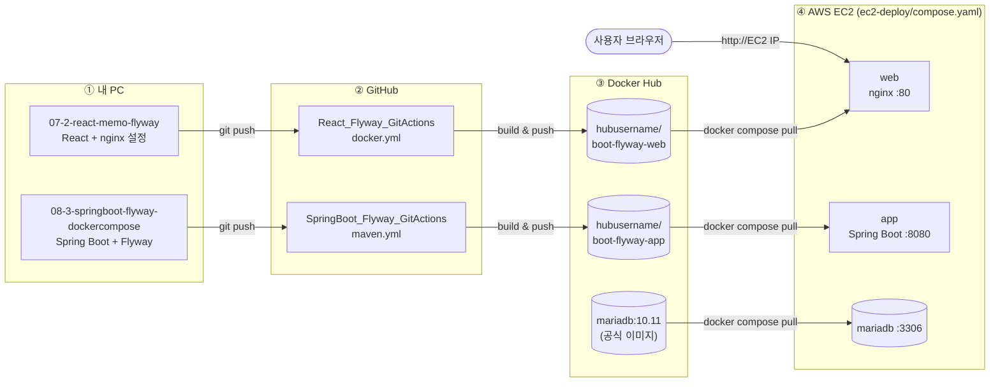
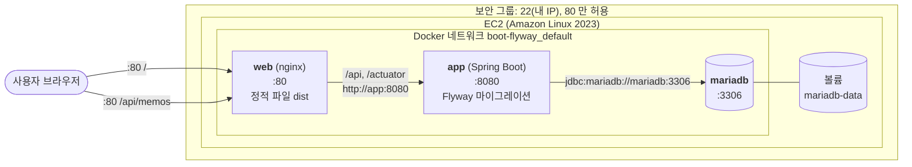
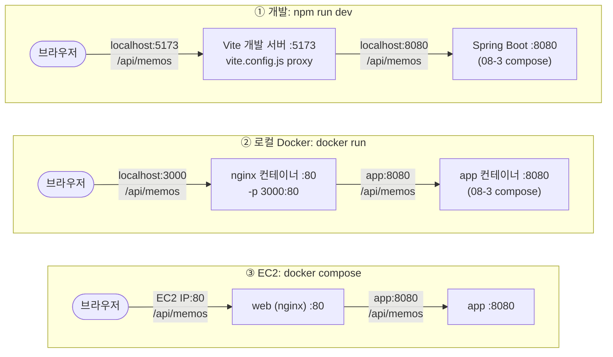
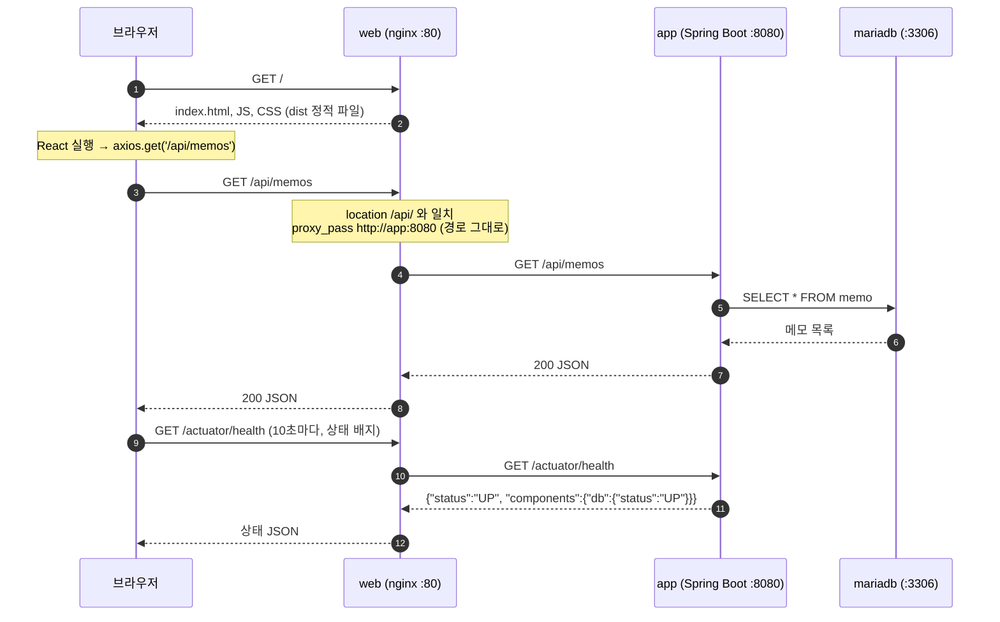

## 단계별 문서

| 단계 | 문서 | 내용 |
|---|---|---|
| 1 | [로컬 개발 서버](docs/01-local-dev.md) | `npm run dev` + Vite 프록시로 서버와 연결 |
| 2 | [Docker로 로컬 테스트](docs/02-docker-local.md) | 배포와 같은 이미지를 내 PC에서 `docker build` / `docker run` |
| 3 | [GitHub Actions → Docker Hub](docs/03-github-actions.md) | main에 push하면 이미지 자동 빌드, 업로드 |
| 4 | [AWS EC2 배포](docs/04-ec2-deploy.md) | EC2 생성, 보안 그룹, `docker compose pull` / `up` |
| - | [문제 해결](docs/05-troubleshooting.md) | 404, 502, 연결 시간 초과 등 |

* * *

## 전체 흐름

코드를 push하면 GitHub Actions가 이미지를 만들어 Docker Hub에 올리고, EC2는 이미지를 **받아서 실행만** 합니다. EC2에는 소스 코드, Node, JDK가 필요 없습니다.



| 단계 | 하는 일 | 관련 파일 |
|---|---|---|
| ① 내 PC | 코드 작성, `npm run dev`로 확인, `docker run`으로 이미지 확인 | `vite.config.js`, `Dockerfile` |
| ② GitHub | main에 push → GitHub Actions 실행 | `.github/workflows/docker.yml` |
| ③ Docker Hub | `:v1`, `:latest` 태그로 이미지 저장 | - |
| ④ EC2 | 이미지 3개를 받아 실행 | `ec2-deploy/compose.yaml`, `.env` |

### EC2 안의 구성

외부에 열린 포트는 **80(HTTP)** 하나입니다. 서버(8080)와 DB(3306)는 Docker 내부 네트워크에서만 통신합니다.



| 컨테이너 | 이미지 | 외부 공개 | 하는 일 |
|---|---|---|---|
| web | `hubusername/boot-flyway-web` | **80** | React 화면 제공, `/api`, `/actuator`를 app으로 전달 |
| app | `hubusername/boot-flyway-app` | 없음 | 메모 API, 시작할 때 Flyway가 테이블 생성 (V1~V3) |
| mariadb | `mariadb:10.11.18` | 없음 (`127.0.0.1:3307`만) | 데이터 저장, 볼륨에 보관 (재시작해도 유지) |

시작 순서는 `mariadb`(healthy) → `app`(healthy) → `web`입니다 (`depends_on`).

* * *

## 프록시 흐름: CORS 없이 서버와 연결하기

서버에는 CORS 설정이 없습니다. 그래서 브라우저는 **항상 화면과 같은 주소**로만 요청하고, 중간의 **프록시**가 서버로 전달합니다. 브라우저 입장에서는 같은 출처라서 CORS 검사가 일어나지 않습니다.

- React 코드의 axios 주소는 어디서든 **`/api` 하나**입니다 (`src/api/memoApi.js`의 `baseURL: '/api'`).
- 환경에 따라 **프록시를 맡는 쪽**과 **서버 주소**만 다릅니다.
- 경로는 **바꾸지 않고 그대로** 전달합니다 (`/api/memos` → 서버도 `/api/memos`).



| 환경 | 브라우저가 요청하는 곳 | 프록시 | 프록시 설정 | 서버 주소를 정하는 곳 |
|---|---|---|---|---|
| 개발 | `localhost:5173` | Vite 개발 서버 | `vite.config.js` | `.env.development`의 `VITE_API_TARGET` (`http://localhost:8080`) |
| 로컬 Docker | `localhost:3000` | nginx | `nginx/default.conf.template` | `docker run -e BACKEND_URL=http://app:8080` |
| EC2 | `EC2 IP:80` | nginx | `nginx/default.conf.template` | `compose.yaml`의 `BACKEND_URL` (기본 `http://app:8080`) |

### 요청 한 번의 흐름 (EC2)



### nginx가 경로별로 하는 일

| 요청 경로 | nginx `location` | 처리 |
|---|---|---|
| `/api/...` | `location /api/` | `proxy_pass ${BACKEND_URL};` → app으로 **경로 그대로** 전달 |
| `/actuator/...` | `location /actuator/` | app으로 전달 (상태 배지용) |
| 그 밖의 모든 경로 | `location /` | `dist`의 파일, 없으면 `index.html` (React가 처리) |

> **`proxy_pass` 끝의 `/` 주의:** `proxy_pass ${BACKEND_URL};`(끝에 `/` 없음)는 경로를 그대로 보냅니다. `proxy_pass ${BACKEND_URL}/;`처럼 `/`를 붙이면 `/api/`가 잘려 서버에 `/memos`로 도착하고 **404**가 납니다. Vite 쪽도 같은 이유로 `rewrite`를 쓰지 않습니다.

> **8080 포트를 열지 않는 이유:** nginx → app 요청은 EC2 **안에서** 일어나므로 보안 그룹을 거치지 않습니다. CORS도 브라우저만 검사하는 규칙이라 서버끼리의 요청에는 적용되지 않습니다.

* * *

## 화면 기능

| 기능 | 호출하는 서버 API |
|---|---|
| 메모 목록 (최신순) | `GET /api/memos` |
| 메모 저장 (500자 제한, Ctrl+Enter) | `POST /api/memos` |
| 메모 삭제 (확인 후) | `DELETE /api/memos/{id}` |
| 앱 / DB 상태 배지 (10초마다) | `GET /actuator/health` |

작성 시각과 다를 때는 서버 V3 마이그레이션으로 추가된 `updatedAt`(수정 시각)도 표시합니다.

## 빠른 시작

```bash
# 서버 실행 (08-3-springboot-flyway-dockercompose 폴더)
docker compose up -d --build

# 클라이언트 실행 (이 폴더)
npm install
npm run dev          # http://localhost:5173
```

자세한 내용은 [1단계: 로컬 개발 서버](docs/01-local-dev.md)를 참고하세요.

## 파일 구성

```
07-2-react-memo-flyway/
├── README.md                     # 이 문서 (전체 흐름, 프록시 그림)
├── docs/                         # 단계별 문서
│   ├── 01-local-dev.md
│   ├── 02-docker-local.md
│   ├── 03-github-actions.md
│   ├── 04-ec2-deploy.md
│   └── 05-troubleshooting.md
├── .env.development              # 개발 서버가 연결할 서버 주소
├── vite.config.js                # 개발용 프록시 (/api, /actuator → 서버)
├── index.html
├── src/
│   ├── main.jsx
│   ├── App.jsx                   # 메모 상태 관리 (목록, 저장, 삭제)
│   ├── index.css                 # 밝은/어두운 테마
│   ├── api/memoApi.js            # axios 호출 모음 (baseURL '/api')
│   └── components/
│       ├── HealthBadge.jsx       # 앱/DB 상태
│       ├── MemoForm.jsx          # 입력 폼
│       ├── MemoList.jsx          # 목록
│       └── MemoItem.jsx          # 메모 1개
├── Dockerfile                    # 1단계 Node 빌드 → 2단계 nginx 실행
├── nginx/default.conf.template   # 정적 파일 + /api, /actuator 프록시
└── .github/workflows/docker.yml  # GitHub Actions (빌드 + Docker Hub push)
```

## 버전 참고

- React 19, Vite 8, axios 1, nginx 1.27
- Node 22 (Dockerfile, GitHub Actions)
- 그림은 [Mermaid](https://mermaid.js.org/)로 작성했습니다. GitHub에서는 바로 그림으로 보이고, VS Code 미리보기에서 보려면 *Markdown Preview Mermaid Support* 확장을 설치하세요.
