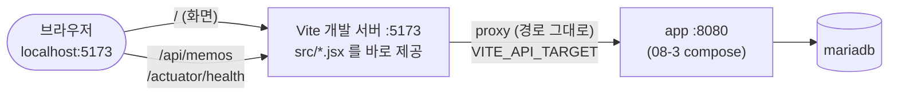

# 1단계: 로컬 개발 서버 (`npm run dev`)

[← README](../README.md) · **1. 로컬 개발** · [2. Docker 로컬 테스트 →](02-docker-local.md)

코드를 고치면서 화면을 바로 확인하는 단계입니다. Vite 개발 서버가 화면을 제공하고, `/api` 요청은 Vite 프록시가 서버로 전달합니다.



## 준비

- Node.js 22 이상 (`node -v`)
- Docker Desktop (서버 실행용)

## 실행

```bash
# 0. 서버 먼저 실행 (08-3-springboot-flyway-dockercompose 폴더에서)
docker compose up -d --build
docker compose ps                           # app 이 Up (healthy)
curl http://localhost:8080/api/memos        # JSON 응답 확인

# 1. 클라이언트 실행 (07-2-react-memo-flyway 폴더에서)
npm install
npm run dev
```

브라우저에서 http://localhost:5173 을 엽니다. 오른쪽 위 배지가 `앱 UP` `DB UP`이면 서버와 연결된 것입니다.

## 관련 설정

**`.env.development`**: 개발 서버가 요청을 전달할 서버 주소

```dotenv
VITE_API_TARGET=http://localhost:8080
```

**`vite.config.js`**: 프록시 설정 (`npm run dev`일 때만 동작)

```js
server: {
  port: 5173,
  proxy: {
    '/api':      { target, changeOrigin: true },   // 메모 API, 경로 그대로 전달
    '/actuator': { target, changeOrigin: true },   // 상태 배지
  },
},
```

**`src/api/memoApi.js`**: React 코드는 서버 주소를 모르고 항상 `/api`로만 요청

```js
const api = axios.create({ baseURL: '/api' })
```

## 알아 둘 점

- `VITE_API_TARGET`과 프록시는 **개발 서버 전용**입니다. `npm run build` 결과물(dist)에는 들어가지 않고, 배포 환경에서는 nginx가 같은 역할을 합니다. 그래서 `.env.production`은 만들지 않습니다.
- `.env.development`를 바꾸면 `npm run dev`를 다시 실행해야 합니다 (Vite는 시작할 때만 읽음).
- 서버 포트를 `"8093:8080"`처럼 바꿨다면 `VITE_API_TARGET=http://localhost:8093`으로 맞춥니다.
- `baseURL`에 `http://localhost:8080`을 직접 쓰면 출처가 달라져 **CORS 오류**가 납니다. `/api` 그대로 두세요.

## 확인

| 확인 | 기대 결과 |
|---|---|
| http://localhost:5173 | 메모 화면, 배지 `앱 UP` `DB UP` |
| 메모 저장, 삭제 | 목록에 바로 반영 |
| http://localhost:5173/api/memos | 서버의 JSON (Vite 프록시를 거친 응답) |
| 서버를 끄고 새로고침 | "백엔드에 연결할 수 없습니다" + 배지 `앱 연결 안 됨` |

---

[← README](../README.md) · [2. Docker 로컬 테스트 →](02-docker-local.md)
