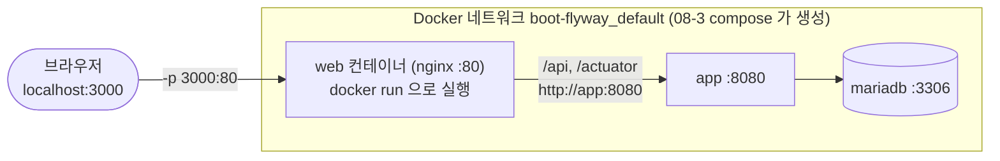
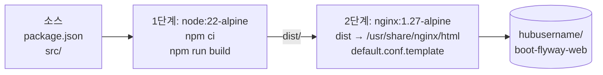

# 2단계: Docker로 로컬 테스트 (`docker build` / `docker run`)

[← README](../README.md) · [← 1. 로컬 개발](01-local-dev.md) · **2. Docker 로컬 테스트** · [3. GitHub Actions →](03-github-actions.md)

EC2에 올릴 이미지와 **똑같은 이미지**를 내 PC에서 만들어 서버와 함께 테스트하는 단계입니다. 이 단계부터는 Vite가 아니라 **nginx**가 화면과 프록시를 맡습니다.



## 이미지가 만들어지는 과정 (Dockerfile)



- 최종 이미지에는 Node와 소스가 없고, **nginx + 빌드된 정적 파일**만 들어 있습니다.
- nginx 설정의 `${BACKEND_URL}`은 **컨테이너가 시작될 때** 환경 변수 값으로 바뀝니다. 그래서 같은 이미지를 로컬과 EC2에서 그대로 씁니다.

## 실행

```bash
# 0. 서버 실행 (08-3-springboot-flyway-dockercompose 폴더에서)
docker compose up -d --build
docker compose ps                      # app 이 Up (healthy)
docker network ls                      # boot-flyway_default 확인

# 1. 이미지 빌드 (07-2-react-memo-flyway 폴더에서)
#    Docker Hub 에 올릴 이름과 같게 붙여 두면 나중에 그대로 push 가능
docker build -t hubusername/boot-flyway-web:latest .

# 2. 실행: 서버의 compose 네트워크에 연결
docker run -d --name boot-flyway-web \
  --network boot-flyway_default \
  -e BACKEND_URL=http://app:8080 \
  -p 3000:80 \
  hubusername/boot-flyway-web:latest

# 3. 확인
docker logs boot-flyway-web            # nginx 오류가 없는지
curl http://localhost:3000/api/memos   # nginx → app 으로 전달되는지
```

브라우저에서 http://localhost:3000 을 엽니다.

PowerShell에서는 한 줄로 입력합니다.
```powershell
docker run -d --name boot-flyway-web --network boot-flyway_default -e BACKEND_URL=http://app:8080 -p 3000:80 hubusername/boot-flyway-web:latest
```

## `docker run` 옵션

| 옵션 | 의미 |
|---|---|
| `--name boot-flyway-web` | 컨테이너 이름 |
| `--network boot-flyway_default` | 서버 compose가 만든 네트워크에 참여 (`name: boot-flyway` + `_default`) |
| `-e BACKEND_URL=http://app:8080` | nginx가 요청을 보낼 서버 주소. 같은 네트워크에서는 **서비스 이름 `app`** 사용 |
| `-p 3000:80` | 내 PC 3000번 → 컨테이너 nginx 80번 |

**포트 숫자의 의미**
```
-p 3000:80
   │    └─ 컨테이너 안 nginx 포트 (nginx 설정 listen 80, 고정)
   └─ 내 PC에서 접속할 포트 (원하는 번호로 변경 가능)
```
- 3000은 설정 파일이 아니라 **이 실행 명령**에서 정합니다. Dockerfile의 `EXPOSE 80`은 표시일 뿐입니다.
- `vite.config.js`의 5173은 `npm run dev` 전용이라 이 단계와 관계없습니다. 3000을 쓰면 개발 서버와 동시에 띄워 비교할 수 있습니다.

**`--network`를 빼면?**
web 컨테이너가 `app`이라는 이름을 찾지 못해 nginx가 **시작하자마자 종료**됩니다 (`host not found in upstream "app"`).

> 다른 방법: Docker Desktop(Windows, Mac)에서는 `--network` 대신 `-e BACKEND_URL=http://host.docker.internal:8080`으로 내 PC의 8080을 거쳐 접속할 수도 있습니다.

## 코드를 고친 뒤 다시 실행

```bash
docker rm -f boot-flyway-web
docker build -t hubusername/boot-flyway-web:latest .
docker run -d --name boot-flyway-web --network boot-flyway_default -e BACKEND_URL=http://app:8080 -p 3000:80 hubusername/boot-flyway-web:latest
```

## 참고: 서버 compose에 web을 추가해서 함께 실행

`docker run` 대신 08-3의 `compose.yaml` `services:` 아래에 추가해도 됩니다. EC2의 `ec2-deploy/compose.yaml`과 같은 구성입니다.

```yaml
  web:
    image: hubusername/boot-flyway-web:latest   # 또는 build: ../07-2-react-memo-flyway
    environment:
      BACKEND_URL: http://app:8080
    ports:
      - "3000:80"
    depends_on:
      - app
    restart: unless-stopped
```

## 정리

```bash
docker rm -f boot-flyway-web     # web 먼저 삭제
# 그다음 08-3 폴더에서 docker compose down
```

> 서버를 먼저 `docker compose down`하면, web이 아직 연결되어 있어서 `boot-flyway_default` 네트워크 삭제가 실패합니다.

---

[← 1. 로컬 개발](01-local-dev.md) · [README](../README.md) · [3. GitHub Actions →](03-github-actions.md)
