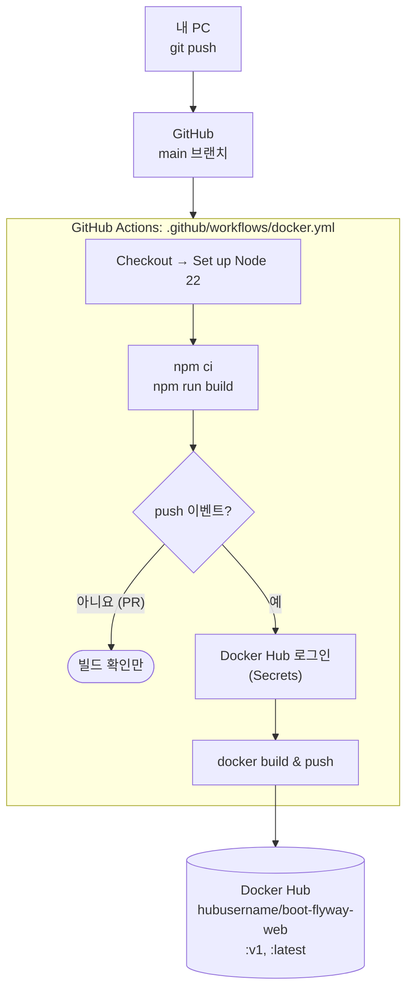

# 3단계: GitHub Actions → Docker Hub

[← README](../README.md) · [← 2. Docker 로컬 테스트](02-docker-local.md) · **3. GitHub Actions** · [4. EC2 배포 →](04-ec2-deploy.md)

main 브랜치에 push하면 GitHub Actions가 이미지를 빌드해서 Docker Hub에 올립니다. 서버(08-3)의 `maven.yml`과 같은 구조입니다.



| 이벤트 | 하는 일 |
|---|---|
| main 대상 Pull Request | `npm ci && npm run build`로 빌드 오류만 확인 |
| main에 push | 빌드 확인 → Docker 이미지 빌드 → Docker Hub push |

## 처음 한 번: Secrets 등록

GitHub 저장소 **Settings > Secrets and variables > Actions > New repository secret**

| 이름 | 값 |
|---|---|
| `DOCKER_USERNAME` | Docker Hub 아이디 (`hubusername`) |
| `DOCKER_PASSWORD` | Docker Hub **Access Token** (Docker Hub > Account settings > Personal access tokens, Read & Write) |

비밀번호보다 Access Token을 권장합니다. 유출되면 토큰만 지우면 됩니다.

## 올라가는 이미지

```
hubusername/boot-flyway-web:v1       ← docker.yml 의 DOCKER_TAG
hubusername/boot-flyway-web:latest   ← EC2 compose 가 받는 태그
```

버전을 올리려면 `docker.yml`의 `DOCKER_TAG: v1`을 `v2`로 바꿔 push합니다. `latest`는 항상 마지막 빌드를 가리킵니다.

## Docker Hub 저장소를 나누는 이유

| 이미지 | 저장소 | 태그 |
|---|---|---|
| 클라이언트 (이 폴더) | `hubusername/boot-flyway-web` | `v1`, `latest` |
| 서버 (08-3) | `hubusername/boot-flyway-app` | `v1`, `latest` |

**저장소는 이미지 종류**, **태그는 버전**을 구분합니다. 한 저장소에 태그로 섞으면 `latest`를 하나밖에 못 쓰고 버전 관리가 꼬입니다.

## 확인

1. GitHub 저장소의 **Actions** 탭에서 워크플로가 초록색(성공)인지 확인
2. Docker Hub 저장소의 **Tags** 탭에 `v1`, `latest`가 새 시간으로 올라왔는지 확인

## 서버 API 경로를 바꿀 때

서버(08-3)와 클라이언트(07-2)는 **같이 배포**해야 합니다. 예를 들어 서버가 `/api/memos`로 바뀌었는데 EC2의 web 이미지가 예전 버전이면 404가 납니다. 두 저장소를 모두 push해서 Actions가 끝난 뒤 EC2에서 `docker compose pull`을 실행하세요.

## 직접 push하는 경우 (Actions 없이)

```bash
docker login
docker push hubusername/boot-flyway-web:latest
```

> Mac(Apple Silicon)에서 빌드한 이미지는 ARM용이라 x86 EC2에서 `exec format error`가 납니다. 이때는 `docker buildx build --platform linux/amd64 -t hubusername/boot-flyway-web:latest --push .`를 쓰거나 GitHub Actions를 이용하세요 (Actions는 x86 이미지를 만듭니다).

---

[← 2. Docker 로컬 테스트](02-docker-local.md) · [README](../README.md) · [4. EC2 배포 →](04-ec2-deploy.md)
