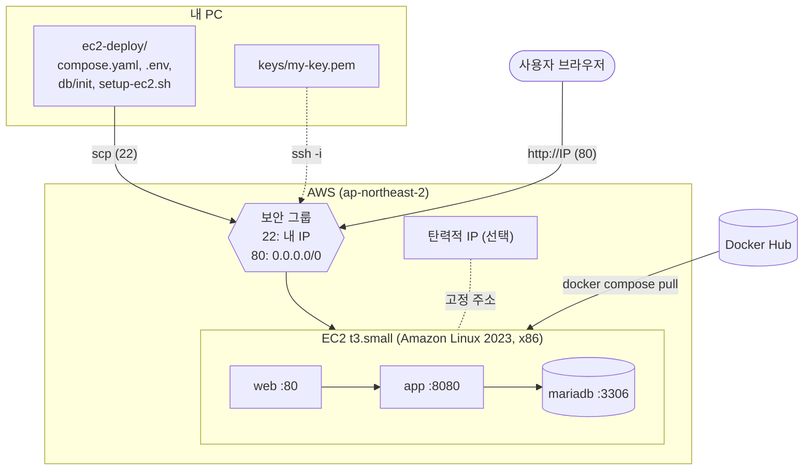

# 4단계: AWS EC2 배포

[← README](../README.md) · [← 3. GitHub Actions](03-github-actions.md) · **4. EC2 배포** · [문제 해결 →](05-troubleshooting.md)

Docker Hub의 이미지 3개(web, app, mariadb)를 EC2 한 대에서 `docker compose`로 실행합니다. EC2에는 **`ec2-deploy` 폴더만** 복사하면 됩니다 (소스 코드 불필요).



## 1. EC2 인스턴스 만들기 (AWS 콘솔)

| 항목 | 권장 값 | 이유 |
|---|---|---|
| AMI | **Amazon Linux 2023 (kernel-6.18)** | AWS 권장 최신 커널. FIPS 인증이 필요할 때만 6.1 |
| 아키텍처 | **64비트(x86)** | GitHub Actions 이미지가 amd64. ARM(t4g)은 `exec format error` |
| 인스턴스 유형 | **t3.small** (2GB) 이상 | t3.micro(1GB)는 스왑을 써도 빠듯함 |
| 키 페어 | 새로 만들기 → `.pem` 다운로드 | 다시 받을 수 없으니 `keys/`에 보관, Git에 올리지 않기 |
| 스토리지 | gp3 20GB | 이미지 3개 + DB 데이터 |

**보안 그룹 (인바운드 규칙)**

| 유형 | 포트 | 소스 | 용도 |
|---|---|---|---|
| SSH | 22 | **내 IP** | 접속, 파일 복사 |
| HTTP | 80 | 0.0.0.0/0 | 화면 + `/api` |

**8080, 3306은 열지 않습니다.** nginx → app → mariadb 통신은 EC2 안의 Docker 네트워크에서 일어나서 보안 그룹을 거치지 않습니다.

## 2. 파일 복사 + 접속 (내 PC)

```bash
chmod 400 ./keys/my-key.pem

# 끝의 :~/ 를 빠뜨리면 서버가 아니라 내 PC에 "ec2-user@IP" 폴더가 생김
scp -i ./keys/my-key.pem -r ./ec2-deploy ec2-user@<EC2 IP>:~/

ssh -i ./keys/my-key.pem ec2-user@<EC2 IP>
```

| `scp` 마지막 인자 | 결과 |
|---|---|
| `ec2-user@IP` (콜론 없음) | 내 PC의 `./ec2-user@IP` 폴더로 복사 (실수) |
| `ec2-user@IP:~/` | 서버의 `/home/ec2-user/ec2-deploy`로 복사 |

## 3. Docker 설치 (EC2, 처음 한 번)

```bash
cd ~/ec2-deploy
bash setup-ec2.sh     # Docker, Compose 플러그인, 스왑 2GB, docker 그룹
exit                  # 다시 접속해야 sudo 없이 docker 사용 가능
```

## 4. 실행 (EC2)

```bash
ssh -i ./keys/my-key.pem ec2-user@<EC2 IP>
cd ~/ec2-deploy

cp .env.example .env && chmod 600 .env
nano .env                       # DOCKERHUB_USERNAME=hubusername, DB 비밀번호

docker compose config           # image 이름에 내 아이디가 들어갔는지
docker compose pull             # 이미지 3개 받기
docker compose up -d
docker compose ps               # mariadb → app → web 순서로 healthy / Up
docker compose logs -f app      # "Successfully applied 3 migrations ... v3"
```

## 5. 확인

주소창에 **`http://`를 직접 붙여** 입력합니다. `IP`만 입력하면 Chrome이 `https://`(443)로 먼저 접속해서 `ERR_CONNECTION_TIMED_OUT`이 납니다.

| 주소 | 기대 결과 |
|---|---|
| `http://<EC2 IP>/` | 메모 화면, 배지 `앱 UP` `DB UP` |
| `http://<EC2 IP>/api/memos` | 메모 JSON |
| `http://<EC2 IP>/actuator/health` | `"status":"UP"` |
| `http://<EC2 IP>:8080/api/memos` | **접속 안 됨** (정상, 8080은 열지 않음) |

서버 안에서 직접 확인할 때:
```bash
docker compose exec web wget -qO- http://app:8080/api/memos
docker logs boot-flyway-web-1      # nginx 접근 로그
```

## 6. 새 버전 배포

두 저장소(07-2, 08-3)를 push해서 GitHub Actions가 끝나면:

```bash
cd ~/ec2-deploy
docker compose pull          # 바뀐 이미지만 새로 받음
docker compose up -d         # 바뀐 서비스만 다시 시작 (DB 데이터 유지)
docker image prune -f        # 이전 이미지 정리
```

## 7. 탄력적 IP (고정 주소, 선택)

인스턴스를 중지했다가 다시 시작하면 퍼블릭 IP가 바뀝니다. 같은 주소가 필요하면 탄력적 IP를 연결합니다.

1. EC2 > 네트워크 및 보안 > **탄력적 IP** > **탄력적 IP 주소 할당** > 할당
2. 새 IP 선택 > 작업 > **탄력적 IP 주소 연결** > 인스턴스 선택 > 연결 ("재연결 허용"은 체크하지 않음)
3. 인스턴스의 퍼블릭 IPv4가 바뀌었는지 확인, SSH와 브라우저 주소도 새 IP로

**요금:** 퍼블릭 IPv4는 자동 IP든 탄력적 IP든 시간당 요금이 있습니다. 탄력적 IP는 **연결을 해제하거나 인스턴스를 중지해도 계속 과금**되고, **릴리스해야** 멈춥니다. 최신 금액은 [Amazon VPC 요금](https://aws.amazon.com/vpc/pricing/)에서 확인하세요.

## 8. 실습을 마칠 때

1. EC2 > 인스턴스 > **인스턴스 종료** (디스크, DB 데이터 함께 삭제)
2. EC2 > 탄력적 IP > **작업 > 탄력적 IP 주소 릴리스** (연결 해제가 비활성화되어 있으면 이미 풀린 상태이니 바로 릴리스)
3. 탄력적 IP, 볼륨 목록이 비어 있는지 확인

잠시 쉴 때는 **인스턴스 중지**만 해도 됩니다. 인스턴스 요금은 멈추지만 디스크(EBS)와 탄력적 IP 요금은 계속 나갑니다.

---

[← 3. GitHub Actions](03-github-actions.md) · [README](../README.md) · [문제 해결 →](05-troubleshooting.md)
