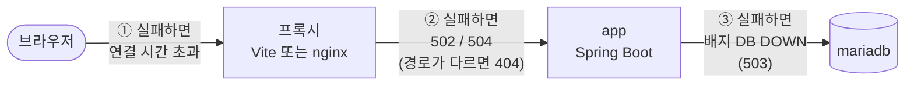

# 문제 해결

[← README](../README.md) · [← 4. EC2 배포](04-ec2-deploy.md)

## 어디서 막혔는지 찾기

요청은 아래 순서로 지나갑니다. 화면의 증상과 HTTP 상태 코드로 어느 구간에서 막혔는지 먼저 찾으세요.



| 증상 | 막힌 구간 | 먼저 볼 것 |
|---|---|---|
| 브라우저: 사이트에 연결할 수 없음, `ERR_CONNECTION_TIMED_OUT` | ① 브라우저 → 프록시 | 주소(`http://`), 보안 그룹 80 |
| 화면: "백엔드에 연결할 수 없습니다", HTTP 502/504 | ② 프록시 → app | app 컨테이너 상태, `BACKEND_URL`, `VITE_API_TARGET` |
| 화면: "요청 실패 (HTTP 404)" | 경로 | 프록시가 `/api`를 잘라내는지, 서버 버전 |
| 배지: `DB DOWN` | ③ app → DB | mariadb 컨테이너, DB 비밀번호 |

## 개발 서버 (`npm run dev`)

| 증상 | 원인 | 해결 |
|---|---|---|
| "백엔드에 연결할 수 없습니다" | 서버가 꺼져 있거나 포트가 다름 | `curl http://localhost:8080/api/memos`, `.env.development` 포트 확인 |
| 메모 목록이 HTTP 404 | 서버가 예전 버전(`/memos`), 또는 `vite.config.js`에 `rewrite`가 남아 있음 | 서버가 `/api/memos`인지 확인, `rewrite` 삭제 |
| 배지만 `앱 연결 안 됨` (메모는 정상) | `/actuator` 프록시 누락 | `vite.config.js`의 `'/actuator'` 확인 |
| 브라우저 콘솔에 CORS 오류 | axios 주소에 `http://localhost:8080`을 직접 씀 | `baseURL`은 `/api` 그대로 |
| `.env.development`를 바꿨는데 그대로 | Vite는 시작할 때만 읽음 | `npm run dev` 다시 실행 |
| 저장 시 HTTP 400 | 빈 내용 | 내용 입력 (서버도 빈 값 거절) |

## 로컬 Docker (`docker run`)

| 증상 | 원인 | 해결 |
|---|---|---|
| `docker run` 직후 컨테이너 종료 | `host not found in upstream "app"`: 서버 네트워크에 연결 안 됨 | `--network boot-flyway_default` 추가, 서버 compose 실행 확인 |
| `network boot-flyway_default not found` | 서버 compose가 꺼져 있음, 또는 `name:`이 다름 | 서버 먼저 `docker compose up -d`, `docker network ls` |
| `container name "/boot-flyway-web" is already in use` | 같은 이름의 컨테이너가 남아 있음 | `docker rm -f boot-flyway-web` |
| HTTP 502 Bad Gateway | app이 시작 중이거나 꺼짐 | 서버 폴더에서 `docker compose ps`, `docker compose logs app` |
| 코드를 고쳤는데 화면이 그대로 | 예전 이미지로 실행 중, 또는 브라우저 캐시 | 다시 `docker build` 후 컨테이너 재생성, Ctrl+Shift+R |

## EC2

| 증상 | 원인 | 해결 |
|---|---|---|
| `ERR_CONNECTION_TIMED_OUT`, 개발자 도구 Request URL이 `https://` | Chrome이 HTTPS(443)로 접속, nginx는 80만 사용 | 주소창에 `http://IP` 직접 입력 |
| 접속 시간 초과 (`http://`로도) | 보안 그룹에 HTTP 80 없음 | 인바운드 규칙에 HTTP 80 추가 |
| SSH 시간 초과 | 보안 그룹 22의 "내 IP"가 바뀜 (와이파이 변경 등) | SSH 규칙의 소스를 현재 내 IP로 |
| `scp` 후 내 PC에 `ec2-user@IP` 폴더가 생김 | 대상 끝의 `:` 누락 | `ec2-user@IP:~/` 로 다시 실행, 잘못 생긴 폴더(`.env` 포함) 삭제 |
| `pull access denied` | `.env`의 `DOCKERHUB_USERNAME` 오타, 또는 Private 저장소 | 아이디 확인, Private이면 EC2에서 `docker login` |
| `exec format error` | ARM 인스턴스에 x86 이미지 | x86 인스턴스 사용 |
| app 재시작 반복, exit code 137 | 메모리 부족 (t3.micro) | `free -h`로 스왑 확인, t3.small 이상 |
| 배포 후 404 (로컬은 정상) | web, app 이미지 버전이 서로 다름 | 두 저장소 Actions 완료 후 `docker compose pull && docker compose up -d` |
| 주소가 바뀌어 접속 안 됨 | 인스턴스 중지 후 시작하면 퍼블릭 IP 변경 | 새 IP 확인, 고정하려면 탄력적 IP |
| nginx 로그에 모르는 IP의 접속 | 인터넷 탐색 봇 (정상) | 22는 내 IP로만, 8080/3306은 열지 않기 |

## 자주 쓰는 확인 명령

```bash
docker compose ps                           # 상태 (healthy 여부)
docker compose logs -f app                  # 서버 로그 (Flyway, 오류)
docker logs boot-flyway-web-1               # nginx 접근, 오류 로그 (EC2)
docker compose exec web wget -qO- http://app:8080/actuator/health   # nginx → app 연결
docker stats --no-stream                    # 컨테이너별 메모리
free -h                                     # 스왑 포함 메모리
```

---

[← 4. EC2 배포](04-ec2-deploy.md) · [README](../README.md)
